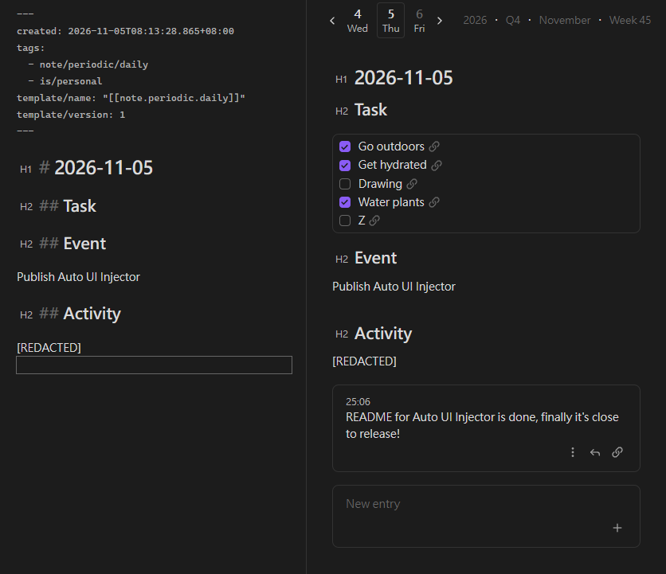
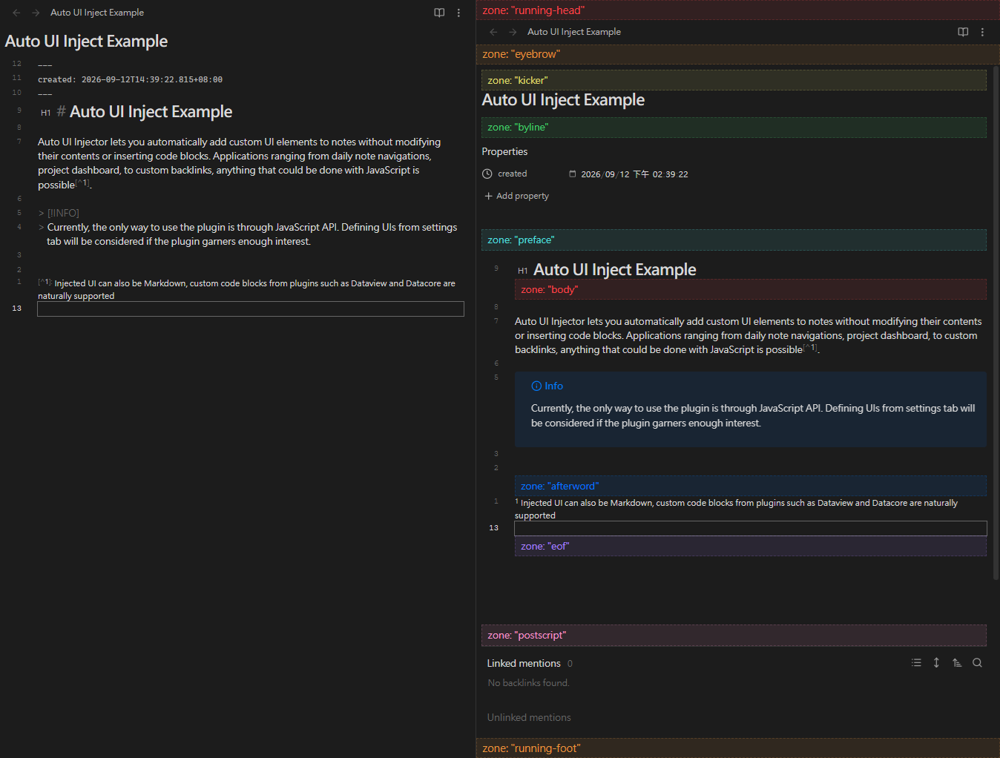

# Auto UI Injector

Auto UI Injector lets you automatically add custom UI elements to Obsidian notes without modifying their contents or inserting code blocks. From daily note navigation and project dashboards to custom backlinks, virtually anything you can build with JavaScript can become part of your notes' interface.

> [!WARNING]
> Currently, the plugin is usable exclusively through its JavaScript API, thus a scripting plugin is required. UI editor in settings tab may be considered in the future if there is sufficient interest.

Transform your notes into feature rich interface:


## Feature

- Automatic injection: Add UI to notes without modifying their contents.
- Flexible positioning: Insert UI into 10 predefined zones, target specific headings or arbitrary document positions.
- Conditional rendering: Decide which notes receive UI based on their view, file, or other context.
- Flexible content: Inject Markdown or custom JavaScript-rendered HTML.
- Live updates across notes: Change an injected UI once and have the change reflected everywhere it appears.
- Keeps UI out of your notes.
- Shows injected UIs in Reading View and Live Preview, but hides them in Source View.

Available zones to inject your custom UI:


## Scope

Auto UI Injector takes care of injecting your UI into rendered notes. It provides convenient insertion points for common use cases, while also allowing you to take full control of placement through JavaScript that interacts directly with Obsidian's internals.

What gets injected is entirely up to you. Whether it's Markdown, Dataview queries, or custom HTML generated by JavaScript, you're free to build whatever your workflow needs.

### Who is this for?

Auto UI Injector at its current state is primarily intended for Obsidian users comfortable with JavaScript and scripting plugins. It provides an interface to insert custom note UI rather than a framework for building widgets.

## Quick Start

The plugin exposes its API through:

```js
const api = app.plugins.getPlugins('auto-ui-injector').api
api.registerAutoUI(spec);  // Register an UI to be injected
api.unregisterAutoUI(spec);  // Unregister an UI
```

The API revolves around UI specifications (`UISpec`). Each specification defines:

- `position`: Where the UI should be inserted.
- `condition`: Which views should receive the UI.
- `content`: What should be rendered.

You can use it with any scripting plugin you prefer, such as CustomJS or CodeScript Toolkit.

```js
// CustomJS script
// Define and registers UI, re-registers when the plugin is re-enabled.

class AutoUIInjectExample {
	constructor() {
		registerAutoUIs();
		// Register when Auto UI Injector is enabled.
		// Repeated registeration is safe, as long as the `UISpec` passed into
		// it is the same object.
		this.pluginChangedEventRef = app.plugins.on('changed', () => {
			registerAutoUIs();
		});
	}

	deconstructor() {
		unregisterAutoUIs();
		app.plugins.offref(this.pluginChangedEventRef);
	}
	
	registerAutoUIs() {
		const api = app.plugins.getPlugin("auto-ui-injector")?.api;
		if (!api) return;
		this.autoUIs.forEach((spec) => api.registerAutoUI(spec));
	}

	unregisterAutoUIs() {
		const api = app.plugins.getPlugins("auto-ui-injector")?.api;
		if (!api) return;
		this.autoUIs.forEach((spec) => api.unregisterAutoUI(spec));
	}

	autoUIs = [
		// Add Datacore code block to all notes under "path/to/daily/notes/"
		{
			// Available zones includes: "running-head", "eyebrow", "kicker",
			// "byline", "preface", "body", "afterword", "eof", "postscript",
			// "end-matter", "running-foot"
			// `order` sorts Auto UIs when multiple are placed in the same zone
			position: { zone: "eyebrow", order: 10 },
			condition: (view) => view instanceof obsidian.MarkdownView
				&& view.file?.path.startsWith("path/to/daily/notes/"),
			content: "```datacorejsx\n" +
                    `const { DailyNavigation } = await dc.require("path/to/script");
                    return <DailyNavigation />` +
                    "\n```",
		},
		// Render Datacore component with JavaScript in notes tagged #note/entry
		{
			position: { zone: "eof", order: 10},
			condition: (view) => {
				if (!(view instanceof obsidian.MarkdownView)) return;
				const path = view.file?.path;
				const cache = app.metadataCache.getCache(path);
				const tags = obsidian.getAllTags(cache);
				return tags.some(tag => /^#note\/entry($|\/)/.test(tag));
			},
			content: (el, view) => datacore.executeJsx(
				`const { EntryFeed } = await dc.require("path/to/script");
				return <EntryFeed parentPath={dc.currentPath()} />`,
				el,
				view,
				view.path
			),
		},
		// Render Markdown under first H1 heading in every Markdown note
		{
			position: {
				zone: "body",
				order: 10,
				// Auto UIs in zone Body has to provide an anchor to describe
				// where in the document body should it inject.
				anchor: {
					type: "section",  // Target headers
					match: {
						level: 1  // Target H1 headings
						// Other matching methods:
						// text: "Exact text",
						// startsWith: "Title prefix",
						// endsWith: "Title suffix",
						// includes: "Title substring",
						// regex: /Matching regex/,
						// All conditions have to satisify to match a heading
					},
					// occurrence: 1,  // Omit occurrence results in first match
				}
			},
			// Auto UI Injector will inject into every view (calendar, explorer,
			// graph view) if not limited to MarkdownView
			condition: (view) => view instanceof obsidian.MarkdownView,
			// See https://docs.obsidian.md/Reference/TypeScript+API/MarkdownRenderer/render
			content: (el, view) => obsidian.MarkdownRenderer.render(
				view.app,
				`${view.file?.path}`,  // Markdown text
				el,
				view.file?.path ?? "",
				view,
			),
		},
		// Position Auto UI within document body with JavaScript
		{
			position: {
				zone: "body",
				order: 10,
				match: {
					// Match first H2 with exact text "Task"
					// type: "section"
					// match: {
					// 	   level: 2,
					// 	   text: "Task",
					// }

					// Same matching condition, but with JavaScript
					type: "raw",
					// tree: https://lezer.codemirror.net/docs/ref/#common.Tree
					// state: https://codemirror.net/docs/ref/#state.EditorState
					locateSourceOffset: (tree, state) => {
						let offset;
						tree.iterate({
							enter(node) {
								if (offset !== undefined) return;
								if (node.name !== "header_header-2") return;
								const { from, to } = node;
								if (state.doc.sliceString(from, to) !== "Task")
									return;
								offset = to;
							}
						});
						return offset;
					},
					// renderer: https://docs.obsidian.md/Reference/TypeScript+API/MarkdownPreviewRenderer
					// Try console.log to reveal more information
					locatePreviewRendererSection: (renderer) => {
						return renderer.sections.find(s => {
							if (s.level !== 2) return false;
							const text = renderer.text.slice(
								s.start.offset + 3,
								s.end.offset
							);
							return text === "Task";
						})
					},
				}
			},
			condition: (view) => view instanceof obsidian.MarkdownView
				&& view.file?.path.startsWith("path/to/daily/notes/"),
			content: "```datacorejsx\n" +
                    `const { DayTask } = await dc.require("path/to/script");
                    return <DayTask />` +
                    "\n```",
		},
	]
}
```

## Motivation

People have been trying to add navigation to daily notes for as long as daily notes have existed. Countless solutions have emerged, from templates to dedicated plugins. One of the most common approaches is insert links at the top of every daily note automatically with Templater.

It works, until you realize that you're constantly scrolling past UI text just to reach your actual content. And when you want to change the navigation, you have to update thousands of existing notes. Refactoring an entire vault just to change its interface is hardly ideal.

Auto UI Injector takes a different approach: keep the UI out of your notes. Injected elements are managed separately from note content, so you can update them once and have the changes reflected across every associated note. Your notes remain clean, readable in plain text, without duplicated navigation links and other interface elements in every note.

## Alternatives

Auto UI Injector isn't the first plugin to tackle this problem. Here are some alternatives, each with its own approach:

- [Note Toolbar](https://community.obsidian.md/plugins/note-toolbar): Feature rich, highly customizable, no-code but also accepts JavaScript.
- [Custom Views](https://community.obsidian.md/plugins/custom-views): Lets you build custom headers using HTML, CSS, and JavaScript, with convenient access to a note's frontmatter through HTML templates.
- [Virtual Content](https://community.obsidian.md/plugins/virtual-footer): Works very similar to Auto UI Injector, but configured through a settings UI. It can render Markdown in header, footer, sidebar, and at the top and bottom of sections.
- [Blueprint](https://community.obsidian.md/plugins/blueprint): Addresses the problem from different angle. Rather than injecting UI, it defines note templates and transforms existing notes to conform to the latest template.
- [Obsidian Typing](https://konodyuk.github.io/obsidian-typing/) (inactive): Defines schemas for notes and renders custom headers and footers for notes matching user-defined types.